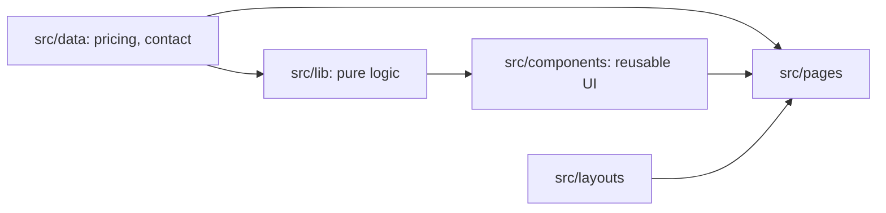

# Architecture

See `docs/adr/` for the reasoning behind each decision.

## Overview

Static Astro site (TypeScript, Tailwind) deployed to GitHub Pages. Pages: Home, Prices (`/prijzen`), Contact (`/contact`).



## Structure

```
src/
  data/        single source of truth (pricing.ts, contact.ts)
  lib/         pure, tested logic (pricing/calculateTotal.ts, money formatting)
  components/  reusable UI (Button, Card, StringFamilyCard, PriceCalculator, LocationMap, ...)
  layouts/     BaseLayout (head/SEO, header, footer)
  pages/       index, prijzen, contact
  styles/      Tailwind setup and tokens
docs/          architecture, ADRs, roadmap
```

## Conventions

- Content/prices/contact details only in `src/data`, never inside components.
- Money as integer cents; formatting via one helper (`nl-NL`, EUR).
- Logic in `lib` has no DOM/framework dependencies and is unit tested.
- Components are small, typed (`Props` interface), accessible and mobile-first.
- Design tokens (colors, spacing, fonts) live in the Tailwind theme only. Look: clean, white space, club-blue brand color, bold sporty headings.

## Layout and design tokens

- `BaseLayout` wraps every page (SEO head, skip link, `Header`, `Footer`, `Container`). Pass `title` and `description` per page.
- Navigation comes from `navItems` in `src/data/site.ts`; a page feature adds its own entry.
- Internal links always go through `withBase()` (`src/lib/withBase.ts`) so they work under the GitHub Pages `/stringatelier` base path.
- Tokens live in `@theme` in `src/styles/global.css`: navy `ink` text, royal-blue `brand` (`brand-strong`, `brand-soft`) taken from the flyer and matching the colours of badminton club Schubad, bold uppercase display headings in brand blue, system fonts (no external font requests, so the site stays fast). Text on a `brand` background is always white. To rebrand, change the tokens only.

## Price calculator

- `calculateTotal` (`src/lib/calculateTotal.ts`) is a pure, unit-tested function: `(service + string) x quantity`, or service only for own strings.
- `PriceCalculator.astro` is a progressive enhancement: hidden by default and revealed by its script, so without JavaScript visitors still see the full price cards.
- It reads the same `src/data/pricing.ts` data as the overview, so prices are only ever changed in one place.

## Contact page

- Contact details, location and handover slots live only in `src/data/contact.ts`; the page renders them.
- `src/lib/phone.ts` formats Belgian numbers for display and builds international `tel:` links (tested).
- No contact form: there is no backend (see ADR 0001). Email and phone are plain `mailto:`/`tel:` links.

## Mobile-first quality gate

- Most visitors use a phone, before or after a session. `tests/e2e/mobile.spec.ts` (Playwright, runs in CI) checks every page at 320, 375 and 414px: no horizontal scroll, nothing outside the viewport, tap targets >= 44x44px, text >= 14px, form inputs >= 16px (prevents iOS zoom), working calculator, tap-to-call and mail links.
- New pages must be added to the `PAGES` list in that spec.

## Prices page design (UX)

Decided with the `ux-designer` role, from the visitor's point of view (a player on a phone who wants their total price):

- **Totals, not add-ons.** String cards show the all-in price per racket (service + string), with the sum underneath (EUR 12,00 + EUR 4,50). Visitors never have to add up prices themselves, and it matches the flyer.
- **Tool first.** The calculator sits next to the EUR 12 service price at the top, in a brand-blue card. The reference cards follow below.
- **Grouped by string type** (BG-65, BG-80, BG-80 Power) with colours as rows, because visitors choose a type first and a colour second. Data lives in `stringFamilies`; the flat `stringOptions` list for the calculator is derived from it.
- **Progressive disclosure.** A native `<details>` "?" per type explains the string on tap, with no JavaScript needed and no hover-only content.
- **Next step.** The page ends with a call to action to the contact page.
