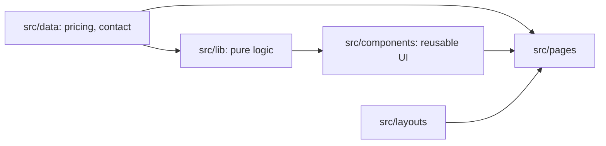
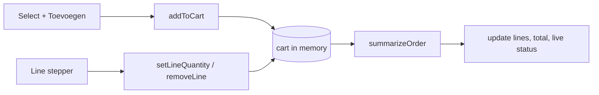

# Architecture

See `docs/adr/` for the reasoning behind each decision.

## Overview

Static Astro site (TypeScript, Tailwind) deployed to GitHub Pages. Pages: Home, Prices (`/prijzen`), Contact (`/contact`).



## Structure

```
src/
  data/        single source of truth (pricing.ts, contact.ts)
  lib/         pure, tested logic (calculateTotal.ts, orderSummary.ts cart helpers, familyPricing.ts, money formatting)
  components/  reusable UI (Button, Card, StringFamilyCard, PriceCalculator, LocationMap, ...)
  layouts/     BaseLayout (head/SEO, header, footer)
  pages/       index, prijzen, contact
  styles/      Tailwind setup and tokens
docs/          architecture, ADRs, roadmap
```

## Conventions

- Content/prices/contact details only in `src/data`, never inside components.
- Money as integer cents; formatting via one helper (`nl-NL`, EUR).
- Logic in `lib` has no DOM/framework dependencies and is unit tested.
- Components are small, typed (`Props` interface), accessible and mobile-first.
- Design tokens (colors, spacing, fonts) live in the Tailwind theme only. Look: clean, white space, club-blue brand color, bold sporty headings.

## Layout and design tokens

- `BaseLayout` wraps every page (SEO head, skip link, `Header`, `Footer`, `Container`). Pass `title` and `description` per page.
- Navigation comes from `navItems` in `src/data/site.ts`; a page feature adds its own entry.
- Internal links always go through `withBase()` (`src/lib/withBase.ts`) so they work under the GitHub Pages `/stringatelier` base path.
- Tokens live in `@theme` in `src/styles/global.css`: navy `ink` text, royal-blue `brand` (`brand-strong`, `brand-soft`) taken from the flyer and matching the colours of badminton club Schubad, bold uppercase display headings in brand blue, system fonts (no external font requests, so the site stays fast). Text on a `brand` background is always white. To rebrand, change the tokens only.

## Price calculator

- `calculateTotal` (`src/lib/calculateTotal.ts`) is a pure, unit-tested function: `(service + string) x quantity`, or service only for own strings. `calculateOrder` sums several such lines, so one order can mix string types (e.g. 2 x BG-65 + 1 x BG-80 + 1 own string).
- `PriceCalculator.astro` renders a picker at build time: a native `<select>` with "Kies een snaar…", then "Eigen snaar (alleen besnaren)", then one `<optgroup>` per entry of `stringFamilies` (options like "BG-65 wit · € 16,50"). It scales to many strings; the cards above it are the part that would need rework at ~6+ families (consider horizontal scroll or a disclosure).
- `src/lib/orderSummary.ts` holds the testable cart logic: `addToCart` (appends, or merges a duplicate with quantity + 1 clamped at `MAX_QUANTITY`, reporting `added`/`merged`/`maxed`), `setLineQuantity`, `removeLine`, `formatRacketCount` and `summarizeOrder` (takes the `Cart`, calls `calculateOrder`, returns rows with id, name, quantity, unit and line totals, racket count and total; `null` for an empty cart so no `€ 0,00` is shown). A cart never holds a line with quantity 0; `setLineQuantity` removes such lines.
- Calculator flow:



- The cart array is the single source of truth. The script in `PriceCalculator.astro` re-renders from it (lines come from a `<template>` and are updated in place, so focus stays on the pressed button) and never reads state back from the DOM.
- Empty state: a short hint and no total. Adding with nothing picked shows "Kies eerst een snaar." (`role="alert"`, `aria-invalid` on the select). After adding, the picker resets and focus returns to it; after removing a line, focus moves to the next line's remove/minus button (the previous line's when the last one was removed), or to the picker when the cart becomes empty. The select gets a red border while invalid.
- A visually hidden `role="status"` element announces changes ("BG-65 wit toegevoegd. 2 rackets, totaal € 33,00."). The visible total is not a live region, to avoid double announcements.
- The card is hidden until its script runs; without JavaScript the `<noscript>` price list next to it is shown instead.
- It reads the same `src/data/pricing.ts` data as the cards, so prices are only ever changed in one place. `summarizeFamilyPrice` (`src/lib/familyPricing.ts`) gives the cards their "from" price and whether colours differ in price.

## Contact page

- Contact details, location and handover slots live only in `src/data/contact.ts`; the page renders them.
- `src/lib/phone.ts` formats Belgian numbers for display and builds international `tel:` and WhatsApp (`wa.me`) links (tested).
- No contact form: there is no backend (see ADR 0001). "Bereik ons" lists each person as a block: name (h3), number as plain text, then equal-width "Bel" (`tel:`) and "WhatsApp" buttons (accessible names "Bel Bjorn", "WhatsApp Bjorn"). The email address (`mailto:`) sits below the people.

## Mobile-first quality gate

- Most visitors use a phone, before or after a session. `tests/e2e/mobile.spec.ts` (Playwright, runs in CI) checks every page at 320, 375 and 414px: no horizontal scroll, nothing outside the viewport, tap targets >= 44x44px, text >= 14px, form inputs >= 16px (prevents iOS zoom), working calculator, call, WhatsApp and mail links.
- New pages must be added to the `PAGES` list in that spec.

## Prices page design (UX)

Decided with the `ux-designer` role, from the visitor's point of view (a player on a phone who wants their total price):

- **Answer first, tool second.** The page header states the € 12 stringing price. The string cards come next and each shows its all-in price per racket with the breakdown ("besnaren € 12,00 + snaar € 4,50"), so most visitors have their answer without touching anything. The calculator follows on a soft band, deliberately secondary ("Meerdere rackets of snaren? Bereken je totaal"). Without JavaScript the calculator is hidden and a `<noscript>` list shows the same prices.
- **Help choosing.** The string section ("Welke snaar past bij jou?") has one card per type (BG-65, BG-80, BG-80 Power): name, character, price, 1-5 dot ratings for power, control and durability, one line with feel and thickness, a "best for" pill and the colours. The ratings come from a comparison table supplied by the owner, translated to a 1-5 scale in `data/pricing.ts`. Dots are decorative; screen readers get "3 van 5" text (`RatingDots.astro`).
- **Grouped by type.** Visitors choose a type first and a colour second, so colours are listed on the card, not as separate cards. The calculator picker lists the colours per type in `<optgroup>`s, and the flat `stringOptions` list is derived from `stringFamilies`.
- **Next step.** The page ends with a call to action to the contact page.

## Visual system and home page (UX)

- **Alternating bands.** Pages are built from full-width `Section` bands (`white`, `soft`, `brand`) so the site is not one white sheet. `BaseLayout` no longer wraps `<main>` in a container; each `Section` does. Page intros use `PageHeader`, and closing calls to action use `CtaBand`. Buttons use `ButtonLink` (`primary`, `secondary`, `inverse`).
- **Blue only.** Colours stay within the brand blue tokens, matching the flyer and the club. The darker footer follows the closing blue band.
- **Home page.** Hero with two clear actions (prices, contact), then three facts at a glance (price, handover slots, turnaround), a three-step "Zo werkt het", and a contact CTA. Visitors mostly arrive before or after training, so the key facts sit above the fold on mobile.
- **Logo and wordmark.** The header always uses the crisp text `Wordmark` (the emblem contains small text that is unreadable at header height). `Logo.astro` shows the emblem from `src/assets/logo.svg|png|webp` in a white badge in the home hero (desktop only, lazy-loaded through `astro:assets` so dimensions are known) and renders nothing when no file exists. The current `logo.png` is a temporary crop of the flyer (transparent background); replace it with the high-resolution file, or an SVG, when available (same filename, no code change). Favicons (`public/favicon-32.png`, `public/apple-touch-icon.png`) are derived from the crossed rackets and should be regenerated from the final logo.
- **Footer.** Brand line, navigation and email, with 44px tap targets.
