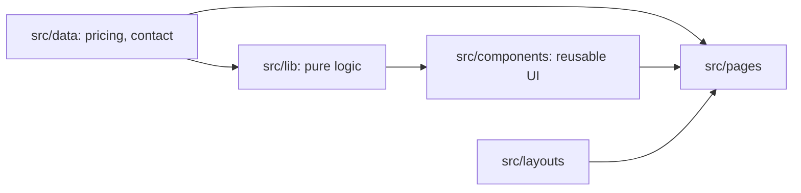

# Architecture

See `docs/adr/` for the reasoning behind each decision.

## Overview

Static Astro site (TypeScript, Tailwind) deployed to GitHub Pages. Pages: Home, Prices (`/prijzen`), Contact (`/contact`).



## Structure

```
src/
  data/        single source of truth (pricing.ts, contact.ts)
  lib/         pure, tested logic (pricing/calculateTotal.ts, money formatting)
  components/  reusable UI (Button, Card, PriceTable, Calculator, ...)
  layouts/     BaseLayout (head/SEO, header, footer)
  pages/       index, prijzen, contact
  styles/      Tailwind setup and tokens
docs/          architecture, ADRs, roadmap
```

## Conventions

- Content/prices/contact details only in `src/data`, never inside components.
- Money as integer cents; formatting via one helper (`nl-NL`, EUR).
- Logic in `lib` has no DOM/framework dependencies and is unit tested.
- Components are small, typed (`Props` interface), accessible and mobile-first.
- Design tokens (colors, spacing, fonts) live in the Tailwind theme only. Look: clean, white space, energetic accent color, bold sporty headings.

## Layout and design tokens

- `BaseLayout` wraps every page (SEO head, skip link, `Header`, `Footer`, `Container`). Pass `title` and `description` per page.
- Navigation comes from `navItems` in `src/data/site.ts`; a page feature adds its own entry.
- Internal links always go through `withBase()` (`src/lib/withBase.ts`) so they work under the GitHub Pages `/stringatelier` base path.
- Tokens live in `@theme` in `src/styles/global.css`: navy `ink` text, electric-lime `accent` (shuttlecock feel), bold uppercase display headings, system fonts (no external font requests, so the site stays fast).
